<div align="center">


# Revyl for bb

**Your agent builds, tests and drives your iOS app on Revyl's cloud,<br>and you watch the device beside the chat.**

Turn on Test on Revyl for a [bb](https://getbb.app) thread. Its agent builds on [Revyl](https://revyl.com)'s runners,<br>proves the change with Revyl tests, and works a cloud device you can watch and touch.

<a href="https://github.com/vburojevic/bb-plugin-revyl/releases/latest"></a>
<a href="https://getbb.app"></a>
<a href="LICENSE"></a>
<a href="https://github.com/get-bb/marketplace"></a>

<sub><a href="#see-it-work">See it work</a> · <a href="#install">Install</a> · <a href="#highlights">Highlights</a> · <a href="#how-it-works">How it works</a> · <a href="#reference">Reference</a></sub>

</div>

<br>

<picture>
  <source media="(prefers-color-scheme: dark)" srcset="assets/screenshots/hero-dark.png">
  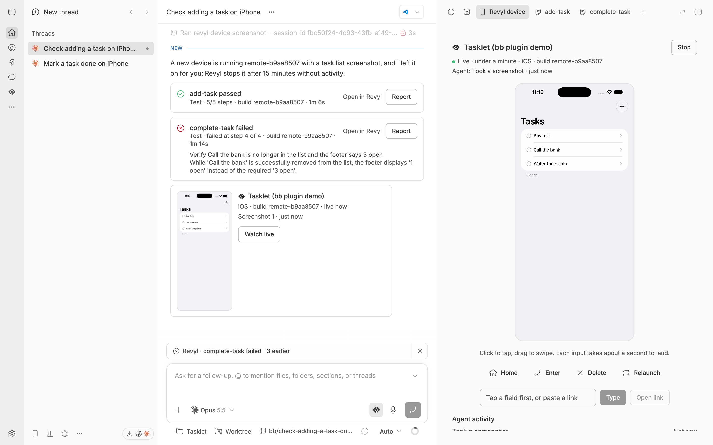
</picture>

<p align="center"><sub>Every screenshot on this page is a real bb window and a real Revyl org (its name and email replaced), shot against a throwaway demo app.</sub></p>

> [!NOTE]
> Unofficial. This plugin is not made by, affiliated with or endorsed by Revyl. The Revyl name and mark belong to Revyl.

## See it work

<table>
<tr>
<td width="44%" valign="top">

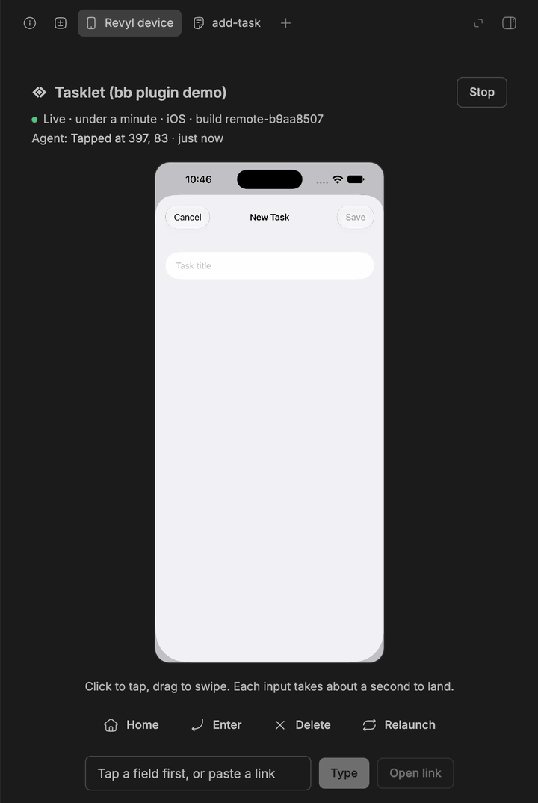

</td>
<td width="56%" valign="top">

**One thread, start to proof.**

1. **Turn on Test on Revyl** in the thread's composer. The agent now builds, tests and runs the app only on Revyl.
2. **It builds on Revyl's runners.** The build appears above the composer and passes or fails there, with the failing step if it breaks.
3. **It proves the change with Revyl tests**, and writes one when none covers it. Each run gets a report with video and steps, and a failed run says which step broke and why.
4. **It works a cloud device**, and the device pane opens beside the chat. You see every tap, swipe and screenshot as it lands, as in this real recording.
5. **It pins the evidence in its reply:** live test results and the screen it saw.

Nothing runs on your Mac, the Revyl key never reaches the agent, and archiving the thread stops whatever it left running.

</td>
</tr>
</table>

## Install

```sh
bb plugin install git:https://github.com/vburojevic/bb-plugin-revyl.git
```

> [!NOTE]
> Requires bb 0.49 or newer, a Revyl account (verified on the free plan) and the Revyl CLI (tested with 0.2.12). Works in Claude Code, Codex and Cursor threads.

Then:

1. Install the Revyl CLI on the machine that runs the bb server, and on any other bb machine whose threads use Revyl: `brew install RevylAI/tap/revyl`, or see [Revyl's install guide](https://docs.revyl.com/install).
2. Open the **Revyl** page (the Revyl mark in bb's left rail) and paste an API key from [app.revyl.ai](https://app.revyl.ai), Settings, API Keys. It stays on the bb server.
3. In a thread of an iOS project, turn on the Revyl mark button in the composer (its tooltip reads Test on Revyl), and ask the agent to change something and prove it.

> [!TIP]
> bb shows up to three plugin buttons in the composer, the ones you click most. If Revyl's isn't one of them, it's in the **More plugin actions** menu, where it reads "Test on Revyl" with its On or Off state.
>
> The plugin also ships a `revyl` skill, so an agent that is asked about Revyl reads how Test on Revyl works before it acts.

## Highlights

<table>
<tr>
<td width="50%" valign="top">

**Test on Revyl, per thread**<br>
One button in the composer. With it on, the thread's agent (Claude Code, Codex or Cursor) builds, tests and runs iOS apps only on Revyl, never on a local simulator.

</td>
<td width="50%" valign="top">

**Builds and tests above the composer**<br>
Every cloud build and test run shows live, then passes or fails. A failed test names the step it stopped at and why; a failed build names its profile, the step that broke and Revyl's error.

</td>
</tr>
<tr>
<td width="50%" valign="top">

**The device beside the chat**<br>
When the agent starts a cloud device, the device pane opens by itself while the thread is open, and streams it live, with each thing the agent does listed as it happens. Take over when the agent is idle: tap, swipe, type, open a link, relaunch the app.

</td>
<td width="50%" valign="top">

**Reports with video and steps**<br>
Open any run for its recording with a step timeline, each step's screenshot and reasoning, Revyl's summary, and the app's CPU, memory, frame rate, warnings and errors.

</td>
</tr>
<tr>
<td width="50%" valign="top">

**Proof in the reply**<br>
`::revyl{task="…"}` pins a live result card in the agent's answer, and `::revyl{device="…" shot="…"}` pins the screen it saw.

</td>
<td width="50%" valign="top">

**The key never reaches an agent**<br>
Agents get a token for their own thread. A proxy on the bb server adds the key and allows one device and one build at a time. Archiving or deleting a thread stops what it left running.

</td>
</tr>
</table>

## Builds and runs above the composer

<picture>
  <source media="(prefers-color-scheme: dark)" srcset="assets/screenshots/runs-dark.png">
  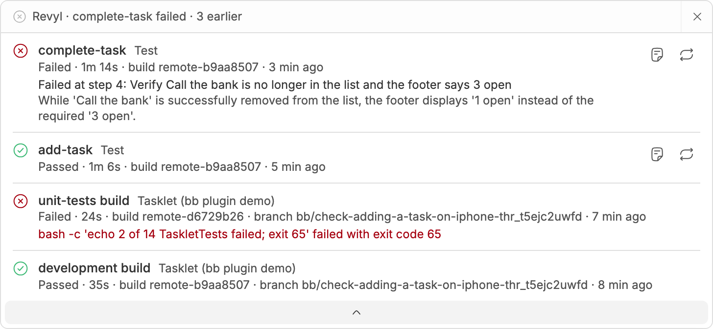
</picture>

Each row is one cloud build, test or workflow run: queued, step 2 of 5, passed or failed, with how long it took and how long ago. A failed test says which step it stopped at and Revyl's reason, so you know whether the app or the test is wrong without opening anything. Each build is named by its profile, such as `development build` or `unit-tests build`, and a failed one shows Revyl's error and suggested fix in full. Open a run's report, run it again on the same build, or cancel it. Starting a run from bb asks first and says how many minutes your plan has left.

## The device pane

<table>
<tr>
<td width="50%" valign="top">

<picture>
  <source media="(prefers-color-scheme: dark)" srcset="assets/screenshots/device-live-dark.png">
  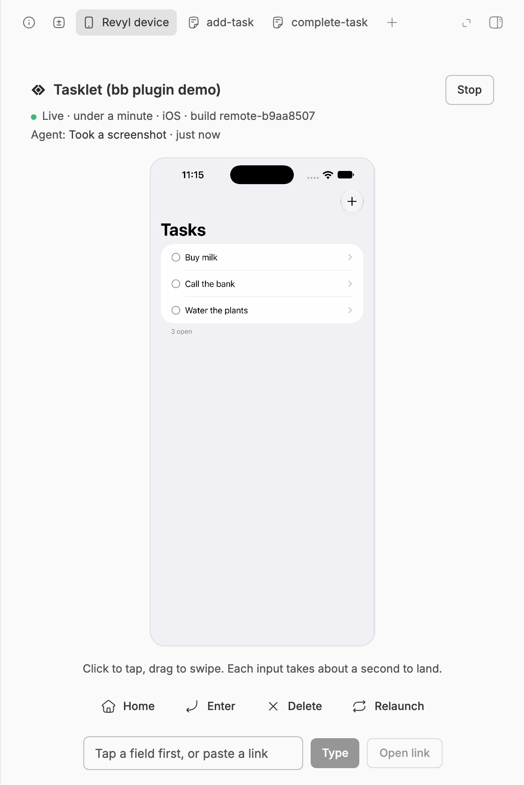
</picture>

</td>
<td width="50%" valign="top">

<picture>
  <source media="(prefers-color-scheme: dark)" srcset="assets/screenshots/device-ended-dark.png">
  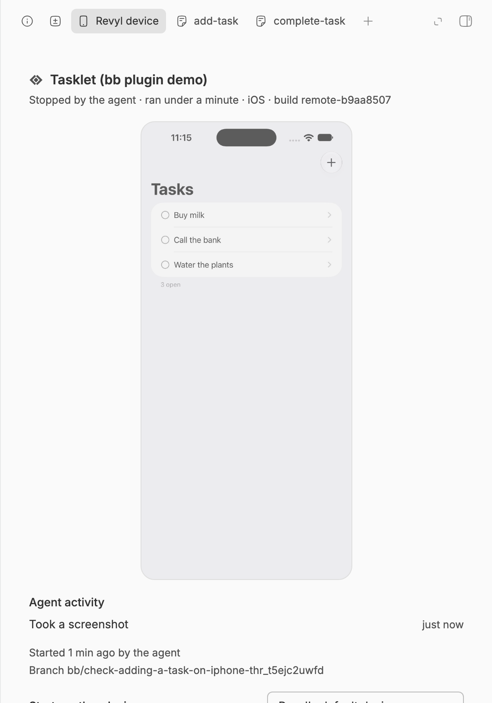
</picture>

</td>
</tr>
</table>

Agents start devices without a browser, so this pane is how you see them. It opens by itself once per device while the thread is open in bb, and follows the thread's device: the app, build and branch, how long it has run, and each tap, swipe, screenshot and keystroke the agent sends (never the text it types). When the agent is idle, click to tap, drag to swipe, type into the field you tapped, press Enter or Delete, paste a link or deep link to open it, or relaunch the app. Starting a device yourself, pick the iPhone or Android model and OS version first. Stop waits until Revyl confirms the device is off, so nothing keeps billing unseen. After the device stops, the pane keeps its last screen and says how it ended: stopped by the agent, from bb, after sitting idle, or with the thread.

## Reports

<picture>
  <source media="(prefers-color-scheme: dark)" srcset="assets/screenshots/report-dark.png">
  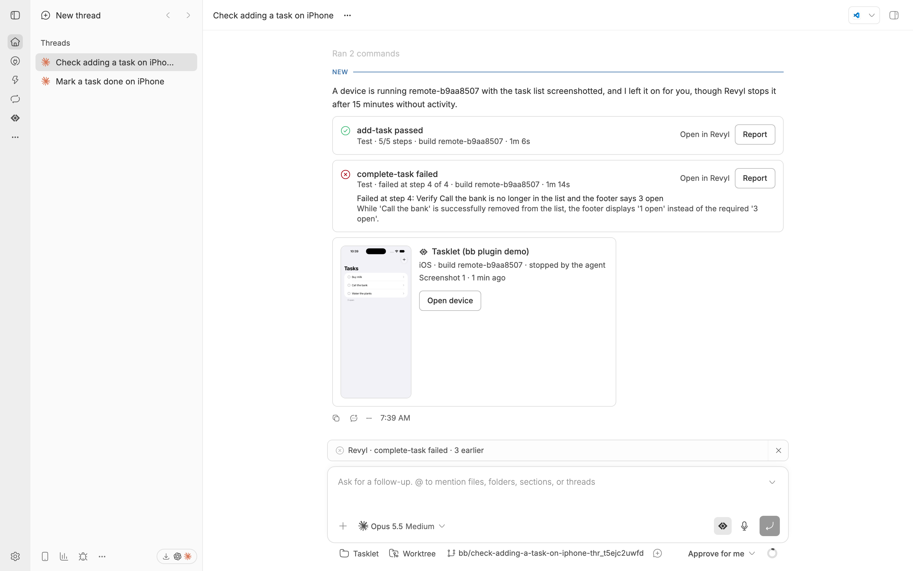
</picture>

A run's recording with a step timeline: click a step to jump the video there, read the reasoning behind each action, and see Revyl's summary of what the test proved. Workflows list their tests, each with its own report. Copy the report link for anyone in your Revyl org.

<table>
<tr>
<td width="46%" valign="top">

<picture>
  <source media="(prefers-color-scheme: dark)" srcset="assets/screenshots/diagnostics-dark.png">
  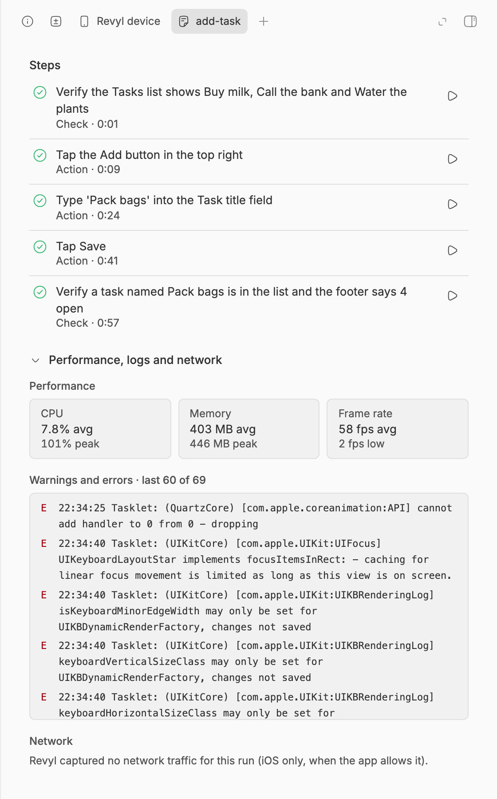
</picture>

</td>
<td width="54%" valign="top">

**Performance, logs and network**

Under the steps, one section answers what the app was doing while the test ran:

- **Performance:** average and peak CPU, memory and frame rate.
- **Warnings and errors:** the app's device log, trimmed to the lines that matter.
- **Network:** failed requests, when Revyl captured the run's traffic.

Revyl reads them when you open the section; bb stores none of it.

</td>
</tr>
</table>

## Proof in the reply

<picture>
  <source media="(prefers-color-scheme: dark)" srcset="assets/screenshots/replies-dark.png">
  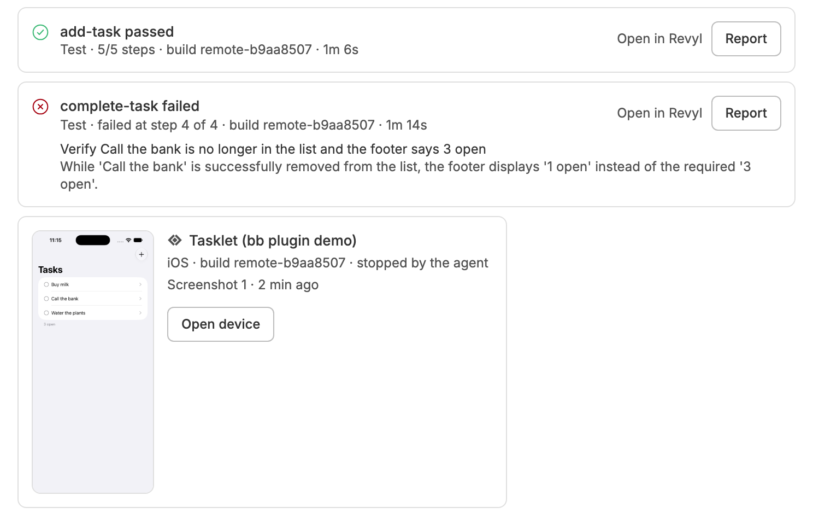
</picture>

The agent pins its evidence where you read its answer. A test card stays live until the run finishes and opens the report. A device card shows the screenshot the agent took, kept even after the device is gone. `bb revyl runs` prints the exact lines to paste.

## The Revyl page

<picture>
  <source media="(prefers-color-scheme: dark)" srcset="assets/screenshots/page-dark.png">
  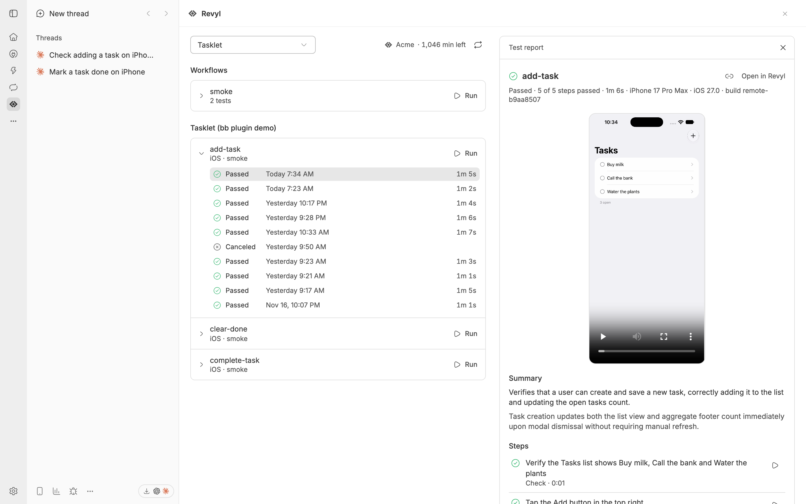
</picture>

Browse the tests and workflows of a project whose repo has Revyl files, or of the whole org. Open one for its recent runs, read any report, and run it. The toolbar shows how many device minutes your plan has left; Settings has the plan, when it resets, and a link to billing.

## How it works

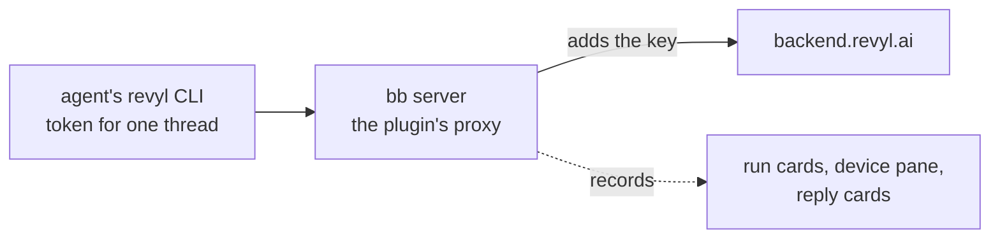

- **The key stays on the bb server.** A thread with Test on Revyl on gets `REVYL_BACKEND_URL`, pointing at the plugin's proxy route, and `REVYL_API_KEY`, a token that works only through that proxy and only for that thread. bb shows a thread's environment in its timeline, so the real key never goes into it. Revyl's account endpoint returns the key, so the proxy replaces it in every reply.
- **Each thread acts only on its own work.** The proxy allows a thread the devices, runs and builds it started, one cloud device and one cloud build at a time, and cuts Revyl's org-wide device lists down to the thread's own. It refuses public links (report share links, `revyl session publish` and Atlas share links work for anyone who has them), Revyl explorations and cloud Macs, which would use minutes outside the thread's limits, and paths written so Revyl would read them as a different route.
- **Build, test and run only on Revyl.** The agent's instructions say to build with `revyl build` on Revyl's runners (it uploads the working tree, uncommitted changes included), prove changes with Revyl tests, write and push a test when none covers the change, set up Revyl in a repo that has none, and never use local `xcodebuild`, simulators or emulators for iOS and Android. macOS targets still build locally. Build secrets are asked for one at a time, through bb's secure input.
- **No forgotten devices.** Archiving or deleting a thread stops its devices and cancels its running tests and builds.
- **Other bb machines.** Their threads reach Revyl through the same proxy (not verified yet). Each needs the `revyl` CLI but no Revyl sign-in.
- **New threads.** The button in the new-thread composer marks the selected project for 30 minutes; the first message you send in a new thread there switches that thread on before its agent starts.
- **Mid-thread.** Flipping the button in a running thread takes effect on the agent's next turn (verified with Claude Code), and adds a one-line note to your next message, because an agent's standing instructions only reload when its session restarts.
- **Fleets.** An orchestrating agent switches a worker on with `bb revyl mode on --thread <worker>`, which applies from the worker's next turn. `--project <id>` applies only to a new thread a person starts. A thread cannot switch itself on or off with that command.

## Reference

<details>
<summary><b>Commands</b></summary>

```text
bb revyl status                      connection, and whether this thread tests on Revyl
bb revyl runs                        this thread's builds, runs and device, with ::revyl lines
bb revyl mode on|off                 switch a thread (--thread <id>), or a project's next new thread (--project <id>)
bb revyl connect --key-file <path>   connect with a key read from a file on the bb server's machine
bb revyl disconnect                  forget the key
```

Every command takes `--json`. A failed test and a failed build in `bb revyl runs` read like this:

```text
test complete-task: failed 4/4
  failed at step 4: Verify Call the bank is no longer in the list and the footer says 3 open
  reason: While 'Call the bank' is successfully removed from the task list, the footer displays '1 open' instead of '3 open' as required by the validation criteria.
  ::revyl{task="5eed0391-6bd6-4821-b0fc-1d3dc7631630"}
build Tasklet (profile unit-tests): failed
  job 111183f1-d627-4934-ad4f-c5b55be01b33 · branch main
  failed step: bash -c 'echo 2 of 14 TaskletTests failed; exit 65'
  error: bash -c 'echo 2 of 14 TaskletTests failed; exit 65' failed with exit code 65
```

</details>

<details>
<summary><b>Settings</b></summary>

<picture>
  <source media="(prefers-color-scheme: dark)" srcset="assets/screenshots/settings-dark.png">
  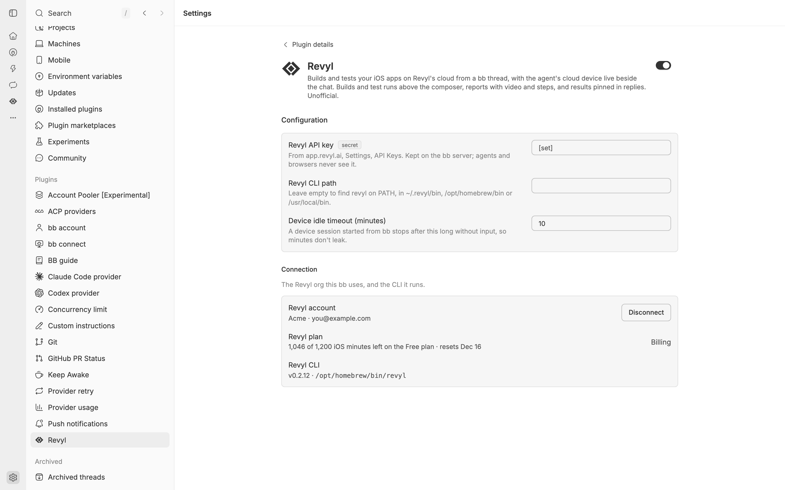
</picture>

| Setting | Default | Meaning |
| --- | --- | --- |
| Revyl API key | empty | Kept in bb's secret settings on the bb server. Agents and browsers never see it. |
| Revyl CLI path | empty | Leave empty to find `revyl` on PATH, in `~/.revyl/bin`, `/opt/homebrew/bin` or `/usr/local/bin`. |
| Device idle timeout | 10 minutes | A device started from bb stops after this long without input. |

</details>

<details>
<summary><b>Privacy and safety</b></summary>

- The real key lives only in the plugin's secret settings on the bb server. The plugin's own CLI calls use it with a private auth folder, never a sign-in stored on the machine. If the bb server's machine has its own `revyl auth` sign-in, the plugin warns, because agents there could use it to skip the per-thread limits.
- Report media links expire after an hour and are fetched fresh, never stored. The device stream URL is used only in the pane and never logged.
- For the device pane, the proxy records each action and its point. It never keeps typed text, its length or an instruction step's text, and keeps only a link's host. It keeps the agent's screenshots in the plugin's database: the latest 12 of each of the thread's 10 latest devices, plus up to 24 per device that replies show. Archiving a thread keeps only those; deleting it removes them all.
- Text you type into the device from the pane goes to the CLI through its environment, never its arguments, so it does not show in the server's process list. Report logs are read when you open them and never stored.
- `revyl device` writes a session file into `.revyl/` of the folder it runs in. The plugin runs its own device commands in a temporary folder. When the agent runs `revyl device` in your repo, the file lands in `.revyl/`, which Revyl's `.revyl/.gitignore` keeps out of git.
- The switch keeps out agents that follow their instructions. bb lets any process on the bb server's machine call a plugin's controls, so it does not stop a determined one.

</details>

<details>
<summary><b>Limitations</b></summary>

- Verified on iOS with the bb server's own machine. Android and threads on other bb machines use the same paths but are not verified yet; the agent's instructions cover iOS builds.
- Test on Revyl sets up `revyl` for Claude Code, Codex and Cursor threads. Other agents get no token.
- Revyl refuses a source archive over 500 MB, and `revyl build` cannot leave paths out. The agent is told to build a repo with large tracked files from a slim copy.
- In a sandboxed agent shell, such as Claude Code's sandbox, Revyl's uploads fail a certificate check, so the agent has to run `revyl` outside the sandbox.
- Each tap or swipe from the pane lands one to two seconds after the click.
- Revyl captures network traffic on iOS only, and only when the app allows it; otherwise the report's Network section says so.
- The proxy relies on `REVYL_BACKEND_URL`, which the Revyl CLI reads but Revyl does not document. Tested with revyl 0.2.12.
- The per-thread limits hold for the agent's `revyl` CLI, which goes through the proxy. bb's plugin RPCs do not say which thread calls them, so a process on the bb machine that calls the plugin's RPCs directly can name another thread. The device pane's input and Stop act only on a device the named thread started.

</details>

<details>
<summary><b>Development</b></summary>

```sh
npm install
npm test            # unit tests: the proxy, run tracking, device actions, stills, formatting
npm run typecheck
bb plugin build
```

`docs/verified.md` records what the Revyl CLI and API actually returned against a live account. `demo/ios` is the small SwiftUI app the screenshots and checks use.

</details>

## More bb plugins

See every bb plugin I publish at [**vburojevic/bb-plugins**](https://github.com/vburojevic/bb-plugins).

<p align="center"><sub>Built by <a href="https://github.com/vburojevic">Vedran Burojević</a> · <a href="LICENSE">MIT</a></sub></p>
